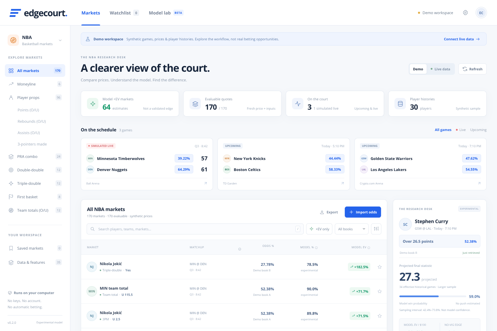

# Edgecourt

**A local C++ NBA market research app, with a Polymarket-inspired browser UI and a Windows executable.**



## Download and run (Windows 10/11 x64)

1. Download **[`releases/Edgecourt-Windows-x64.zip`](releases/Edgecourt-Windows-x64.zip)** and extract it.
2. Double-click **`Edgecourt.exe`**. Your default browser opens the local dashboard.
3. Keep the executable's console window open. Closing it or pressing **Ctrl+C** stops the server.
4. Start in **Demo** to explore the interface, or select **Live data** to request public NBA/ESPN feeds. The two modes never silently substitute for one another.

The executable embeds its browser assets. **No API keys, subscription, account, Python, Node, OpenSSL installation, or external web server is needed at runtime on Windows.** It uses Windows' WinHTTP HTTPS client and listens on `127.0.0.1`, preferably port `8741` (an available port is selected if occupied).

The binary is unsigned and cross-compiled in Linux. Its x64 PE format and system-only DLL imports were checked, but **it has not been executed on Windows in this sandbox**. Windows/SmartScreen may warn about an unsigned executable. Verify `releases/SHA256SUMS.txt`, inspect the source, or build it yourself; do not disable your computer's security protections. A native Windows build-and-test workflow is included.

## Important: what this does and does not do

This is a **working experimental baseline**, not a proven profitable or calibrated betting model. “Model +EV” means positive expected value *under an unvalidated estimated distribution*. It is not a verified betting edge, a guarantee, or a backtested performance claim.

- Public ESPN/NBA endpoints are **keyless but undocumented/unstable**; availability, schemas, rate limits and network restrictions can change.
- ESPN supplies schedules and **explicit moneylines when included in a response**. Keyless moneylines also come from Polymarket (traded probabilities), Kalshi (exchange market data) and Pinnacle's anonymous guest feed; only markets matching a scheduled game are kept and exchange prices are labeled indicative. The app never invents bookmaker prices. The full catalog is `docs/KEYLESS_SOURCES.md`.
- **There is no bundled reliable free/keyless all-books live player-prop feed.** Points, rebounds, assists, threes, PRA, double/triple-doubles, first-basket and team-total prices can be imported through CSV/JSON or added individually. NBA/ESPN statistical inputs are fetched automatically where available.
- **Odds are displayed and entered as bookmaker-implied percentages**, including book margin, separately from Model %. Legacy American-odds files remain supported; calculations preserve the original payout, without rounding through an American conversion.
- First basket requires **5 confirmed current starters per team** and historical first-made-field-goal opportunities. The optional local play-by-play archive supplies dated observations; PPG is not used as a proxy. Past starters never confirm today's lineup. Different first-score/first-FG settlement rules must not be mixed.
- In-play props require **fresh accrued player stats**, not just pregame averages. Preseason projections are suppressed because regular-season minutes do not reliably describe preseason rotations.
- The sandbox preview cannot reach ESPN/NBA hosts. Adapters were tested against schema fixtures, **not verified against current live provider responses here**.
- **No full Basketball Reference crawl was run here and no historical corpus is bundled.** A permission-gated, resumable historical collector is provided, with honest archive coverage in Model lab. Source/model-use permission and a permitted network are needed. See [historical data setup](docs/HISTORICAL_DATA.md).
- No sportsbook login, bet placement, anti-bot bypass, paid API, credential collection, or auto-betting is implemented.

## Features

- Upcoming and live NBA schedule — preseason, regular-season and postseason games kept as published — with scores, clock and explicit public moneylines, shown as percentages on schedule cards, market rows, research panels and CSV exports. ESPN's scoreboard is fetched one day at a time (its hyphenated date ranges now return HTTP 400), and the public moneyline venues are fetched before stats enrichment so the shared request budget cannot starve them.
- **Dark mode:** the moon/sun button in the header switches instantly, Settings → Appearance offers System / Light / Dark, and the choice is saved only in this browser. System follows your OS setting until you choose otherwise.
- Optional all-discovered-season NBA play-by-play archive: SQLite/gzipped raw pages outside Git, paired box-score vectors, dated first-FG opportunities, streaming native feature loading, coverage/gap reporting and atomic local reload.
- All requested market types: **moneyline; points, rebounds, assists, 3PM O/U; PRA; double-double; triple-double; first basket; team totals O/U**.
- Joint weighted empirical-bootstrap player predictions, transparent moneyline/team-total baselines, push-aware EV and same-book matched no-vig comparisons.
- **35-signal inventory:** 20 model inputs, 6 context-only signals, 4 eligibility guards and 5 explicitly unimplemented future inputs. The research panel lists fields actually available for each estimate.
- Injury context, recent minutes, home/away weighting, pace, team ratings, chronological Elo, rest differential, joint stat covariance and live accrued stats.
- Search, market/book/game/status filters, +EV/minimum-EV filtering, sorting, pagination, watchlist, research panel, CSV export, data-health/model-lab pages and responsive layouts.
- Atomic CSV/JSON import validation, a constrained public-ESPN-HTML schema-fallback scraper, and saved-HTML data extraction. HTML/JavaScript is never executed by the scraper.
- Optional illustrative quarter-Kelly sizing, **off by default**, capped at 2% of the illustrative bankroll. It is unreliable without calibrated probabilities.
- Local persistence, response limits, fixed HTTPS source allowlist, no redirects, CSRF token, Origin/Host checks, no wildcard CORS, escaped UI text and CSV formula-injection protection.
- C++ historical-prediction scoring CLI: Brier score, log loss, push-aware selection, flat-stake ROI and a pregame timestamp guard. Optional head-to-head scoring against every row's closing no-vig market probability, including per-market breakdowns and approximate game-clustered uncertainty. No fabricated accuracy metrics or outperformance claims.

### Freshness

EV is disabled for pregame quotes older than **15 minutes** and live quotes older than **90 seconds**. Live scoreboard/player data must also be at most 90 seconds old. Eligibility is rechecked at API-read time, even when model calculations are cached. Imported quote timestamps are never made fresh by refresh/restart.

Public sources refresh every 60 seconds; NBA statistics cache for 6 hours, rosters for 1 hour. Limited historical-cache fallback is explicit. Synthetic demo timestamps refresh separately; imported demo quotes still age normally. Demo imports are temporary and reset on a manual demo refresh.

## Import real research inputs

Use **Import odds → Add a quote**, choose the displayed game, enter its player/team, line, side, bookmaker odds percentage and book. Or use **File / paste** for CSV, JSON and supported saved HTML. The CSV template uses the current workspace's real game ID but leaves the price blank; you must supply actual odds.

A quote alone does not supply missing history. JSON can include `games`, `teams` and `players` with raw game logs. Read **[the import specification](docs/IMPORTS.md)** for exact fields and settlement rules. User-provided prices/statistics are clearly marked as unverified.

For a synthetic feature-import example (Demo mode only):

```sh
python scripts/make_sample_import.py > sample-import.json
```

## Historical play-by-play

The optional collector supports NBA season ending years from 1997 onward and archives every parsed timed event for discovered completed games, paired with full-game box scores. It reports missing/rejected games rather than claiming complete coverage. **No historical crawl has been executed or data bundled in this sandbox.** Obtain appropriate Sports Reference permission before collection/use; follow the [setup guide](docs/HISTORICAL_DATA.md).

After installing/exporting a permitted archive:

```sh
./build/Edgecourt --live --data-dir edgecourt-data
# Or local history and your imports, without public network requests:
./build/Edgecourt --live --offline --data-dir edgecourt-data
```

The Model lab's **Reload local history** button validates a replacement `history/features.jsonl` atomically. The model uses recent complete regular-season vectors and dated historical first-FG opportunities, not all decades-old games as an undifferentiated training set. Current schedules, prices, lineups and freshness guards still matter. The model remains untrained/uncalibrated.

## Build from source

Dependencies are vendored: `cpp-httplib` **v0.22.0** and `nlohmann/json` **v3.12.0**. No dependency download is needed to compile the app. Python embeds HTML/CSS/JS **at build time**. It is also used by the **optional historical collector**, separately from the executable. The app itself still needs no Python or SQLite runtime.

### Windows / Visual Studio

Install Visual Studio's **Desktop development with C++**, CMake 3.20+ and Python 3. Run from an x64 developer shell:

```powershell
./scripts/build-windows.ps1
```

Or manually:

```powershell
cmake -S . -B build/windows -A x64
cmake --build build/windows --config Release --parallel 2
ctest --test-dir build/windows -C Release --output-on-failure
./build/windows/Release/Edgecourt.exe
```

### Linux development / preview

Requires a C++17 compiler, CMake 3.20+, Python 3 and `curl` (Linux public-HTTPS transport only):

```sh
cmake -S . -B build -DCMAKE_BUILD_TYPE=Release
cmake --build build --parallel 2
ctest --test-dir build --output-on-failure
./build/Edgecourt --demo
# A proxied development preview, not the desktop default:
./build/Edgecourt --demo --host 0.0.0.0 --port 3000 --no-browser
```

Browser calls use relative `/api/...` URLs. The embedded server accepts the Arena `.e2b.app` preview host and does not block iframe embedding. Desktop users should retain the loopback default, not expose an unauthenticated GET API publicly.

### Windows cross-build

With **Zig 0.13.0** installed:

```sh
ZIG=/path/to/zig bash scripts/build-windows.sh
```

This builds `releases/Edgecourt.exe` with static C++ runtime libraries; remaining imports are Windows/UCRT system DLLs. Cross-compilation does not substitute for a Windows runtime test.

## Tests and validation

- **71 C++ test cases** and **19 offline historical collector tests**; `edgecourt_tests` reports the current count.
- Native historical pipeline test: synthetic saved pages → complete event archive → feature export → live/offline native estimates, dated first-FG counts, current lineup import, atomic reload and removed-bundle cleanup.
- Native-process API tests: assets, Host/Origin/token guards, synthetic isolation, imports, deduplication, atomic failures, CSV templates and refresh.
- Browser interaction tests: categories/search/EV/game/status filters, watchlist, imports/errors, XSS escaping, export, pagination, settings, model lab and mobile layout.
- `.github/workflows/build.yml` builds/tests on Windows and Linux and uploads the Windows executable when run.

Optional browser test (development only):

```sh
npm install --no-save --package-lock=false --prefix .cache/browser playwright-core@1.58.2 @sparticuz/chromium@143.0.4
node tests/browser_smoke.mjs http://127.0.0.1:3000
```

Set `EDGECOURT_CHROMIUM` for an existing Chrome/Chromium executable, and `EDGECOURT_BROWSER_MODULES` to override the development node_modules path. The browser test expects a Demo server. None of these packages are shipped in the app.

Score **synthetic example** historical predictions (not evidence of an edge):

```sh
./build/Edgecourt --backtest samples/backtest-example.json
# Paired model-vs-closing-market scoring example (also synthetic):
./build/Edgecourt --backtest samples/market-backtest-example.json
# Windows:
./Edgecourt.exe --backtest samples/backtest-example.json
```

For real market comparisons, see the field definitions and leakage guards in [Model mathematics and limitations](docs/MODEL.md). There is no authentic historical market benchmark bundled with this repository.

## Documentation

- [Historical play-by-play collection, permissions, coverage and model use](docs/HISTORICAL_DATA.md)
- [Data sources, limits and scraping policy](docs/DATA_SOURCES.md)
- [Model mathematics and limitations](docs/MODEL.md)
- [Import formats and feature records](docs/IMPORTS.md)
- [GitHub reference scan — 33 projects, licenses and decisions](docs/GITHUB_REFERENCES.md)
- [Architecture and security](docs/ARCHITECTURE.md)
- [Test/build report](docs/VALIDATION.md)
- [Third-party notices](THIRD_PARTY_NOTICES.md)

New application code is MIT licensed. Public access is not permission to redistribute provider data; comply with each source's terms, robots policies and local laws. Use only where legal and age-eligible. Never stake money you cannot afford to lose.
